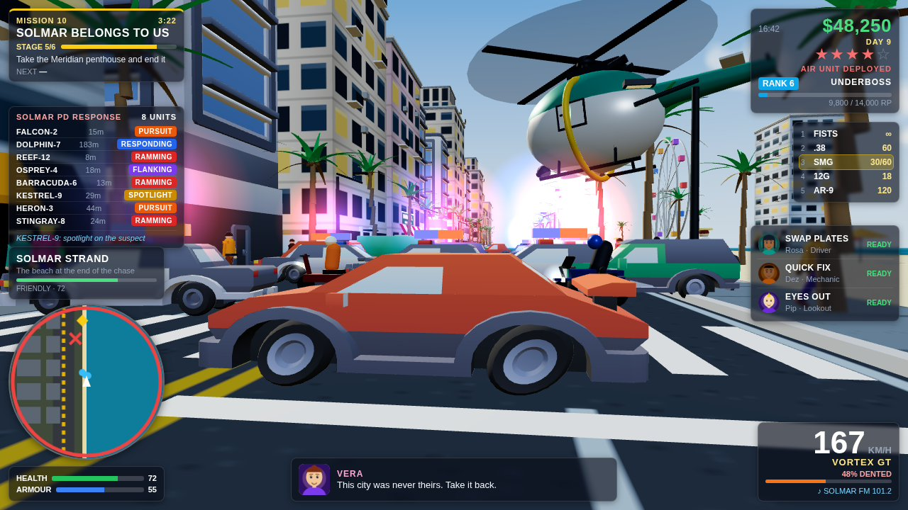
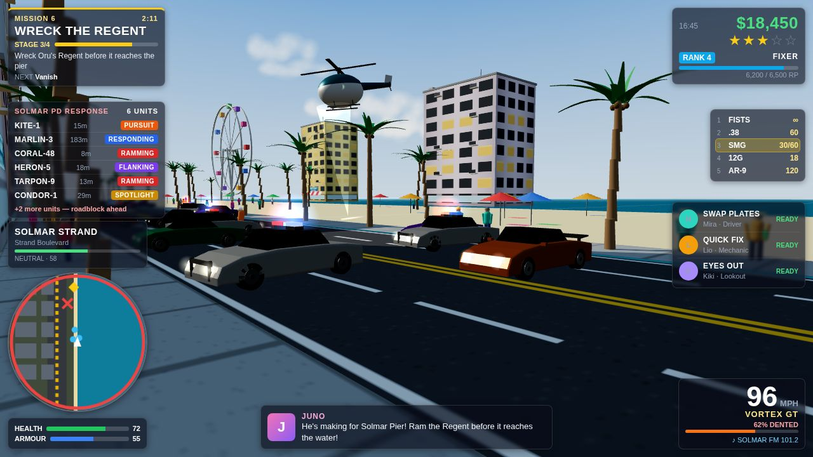
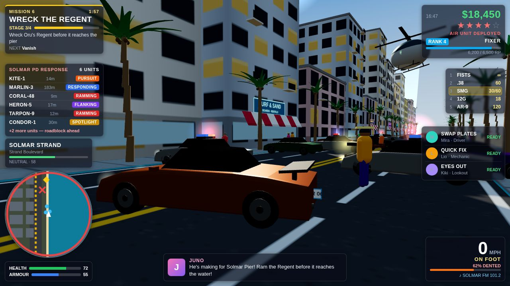
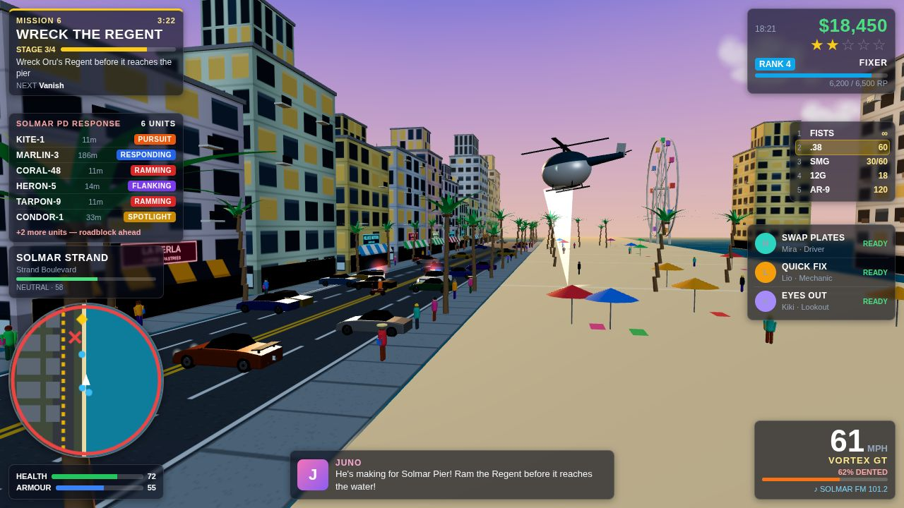

# Solmar City 3D — Make GTA 6 (gta6-01, round 9)

[](https://make.fun/bounty/gta6-01?utm_source=github&utm_medium=readme&utm_campaign=gta6-01)
[](https://make.fun/bounty/gta6-01/leaderboard?utm_source=github&utm_medium=readme&utm_campaign=gta6-01)
[](https://make.fun/bounty/gta6-01?utm_source=github&utm_medium=readme&utm_campaign=gta6-01)

An open-world 3D driving game in the browser: a sun-soaked beach boulevard,
ten story missions, a crew to build, and Solmar PD closing in from every
direction. You are Alex "Vex" Marlowe, a driver fresh off the ferry — steal a
car, run the jobs, climb from nobody to kingpin.






## Play

```bash
node serve.ts
```

Then open http://localhost:8080 in a desktop browser. No build step, no
network needed at runtime: Three.js is vendored under `game/vendor/`, and
every texture is drawn procedurally in code.

## Controls

| Key | Action |
| --- | ------ |
| W / A / S / D | Drive (accelerate, steer, brake) |
| Space | Handbrake |
| F | Get in / out of the car |
| M | Mira's ability — swap plates, drop a wanted star |
| L | Lio's ability — quick repair |
| K | Kiki's ability — reveal police on the minimap |
| 1–5 | Switch weapon (fists, .38, SMG, 12G, AR-9) |
| Esc | Pause |

## What's in the game

- **A living city:** a beach boulevard with pastel towers, neon shop signs,
  striped awnings, curved palms with drooping fronds, a Ferris wheel on the
  pier, traffic, pedestrians, a scooter rider and beach umbrellas.
- **Ten story missions** across seven districts, from FIRST GEAR to SOLMAR
  BELONGS TO US, with named contacts, dialogue and payouts.
- **A five-star wanted system:** patrols, PIT attempts, roadblocks, spike
  strips and the CONDOR-1 helicopter with a spotlight at four stars.
- **A crew with abilities:** Mira (driver), Lio (mechanic), Kiki (lookout).
- **Progression:** cash, RP, seven respect ranks from NOBODY to KINGPIN,
  district standing, a garage, five weapons, and save/load via localStorage.
- **Procedural audio:** engine hum, siren wail and a radio jingle, all
  synthesized with WebAudio — no audio files.

## Screenshots

The four staged shots (`shots.json`, all `?seed=1` for a fixed city):

1. `1-chase.jpg` — four-star chase, 104 MPH, low close camera, four cruisers with flashing light bars, CONDOR-1 large overhead with a white spotlight cone on the car, roadblock ahead
2. `2-beach.jpg` — beach drive, hero car in frame, ocean on the right, Ferris wheel ahead
3. `3-shootout.jpg` — on foot in the open, SMG out with a muzzle flash, hit spark on the target car
4. `4-golden-hour.jpg` — golden-hour vista down the whole boulevard

Round 9 restaged the shots against the top-10 covers: closer cameras,
a bigger helicopter with a brighter cone, brighter cruiser light bars,
setback rooflines and glass storefronts on the towers, a lighter road,
and more traffic and pedestrians in frame.

## Layout

- `game/` — the game (index.html, style.css, src/, vendor/three.module.min.js)
- `screenshots/` — the four staged JPEGs
- `main.ts` — entrypoint: copies game/ + screenshots/ into the output
  directory and writes `dossier.json` (writes only inside the output dir)
- `serve.ts` — local static server for playing the game
- `vendor/makefun-game.ts` — the competition kit's dossier builder (unchanged)

## License

MIT — see [LICENSE](LICENSE).
