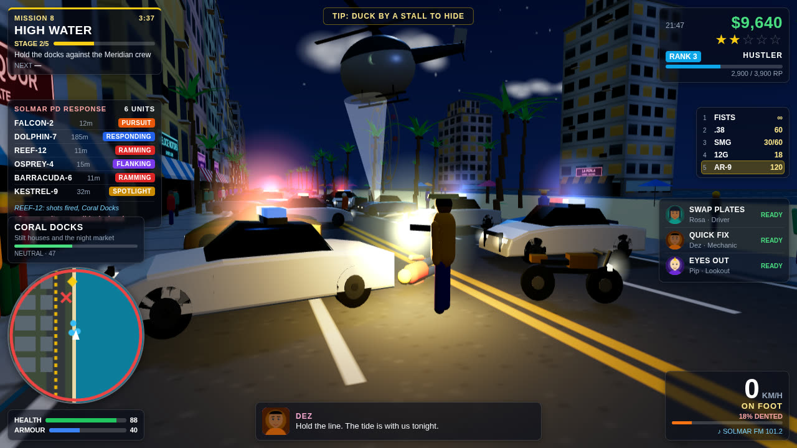
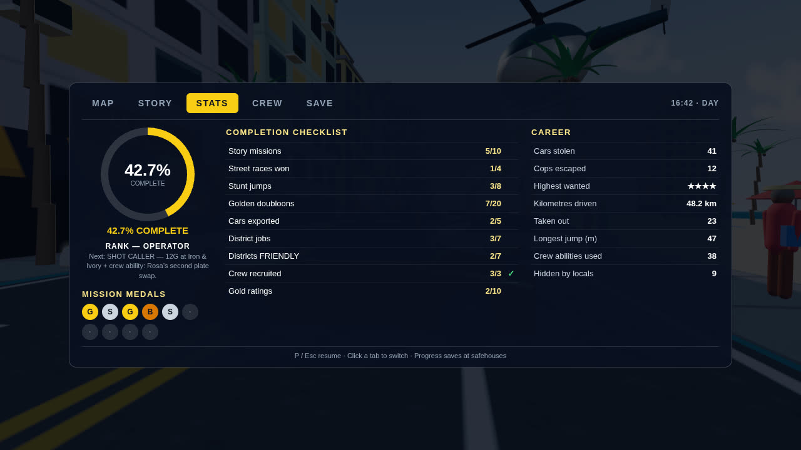
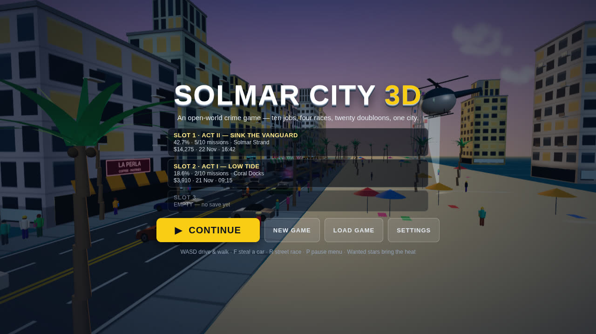

# Solmar City 3D — Make GTA 6 (gta6-01, round 10)

[](https://make.fun/bounty/gta6-01?utm_source=github&utm_medium=readme&utm_campaign=gta6-01)
[](https://make.fun/bounty/gta6-01/leaderboard?utm_source=github&utm_medium=readme&utm_campaign=gta6-01)
[](https://make.fun/bounty/gta6-01?utm_source=github&utm_medium=readme&utm_campaign=gta6-01)

An open-world 3D crime game in the browser: a sun-soaked beach boulevard,
ten story missions, four street races, a crew to build, and Solmar PD
closing in from every direction. You are Alex "Vex" Marlowe, a driver fresh
off the ferry — steal a car, run the jobs, climb from nobody to kingpin.






## Play

```bash
node serve.ts
```

Then open http://localhost:8080 in a desktop browser. No build step, no
network needed at runtime: Three.js is vendored under `game/vendor/`, and
every texture is drawn procedurally in code.

## Controls

| Key | Action |
| --- | ------ |
| W / A / S / D | Drive (accelerate, steer, brake) |
| Space | Handbrake |
| F | Get in / out of the car |
| M | Rosa's ability — swap plates, drop a wanted star |
| L | Dez's ability — quick repair |
| K | Pip's ability — reveal police on the minimap |
| R | Start a street race |
| 1–5 | Switch weapon (fists, .38, SMG, 12G, AR-9) |
| P / Esc | Pause menu (MAP / STORY / STATS / CREW / SAVE) |

## What's in the game

- **A living city:** a beach boulevard with pastel towers, neon shop signs,
  striped awnings, curved palms with drooping fronds, a Ferris wheel on the
  pier, traffic, pedestrians, a scooter rider and beach umbrellas — plus a
  real day/night cycle with a moon, stars and neon nights.
- **Ten story missions** in three acts across seven districts, from FIRST
  GEAR to SOLMAR BELONGS TO US, with named contacts, full dialogue screens
  with painted portraits, and payouts.
- **Four street races** with checkpoints, rival drivers, gold/silver target
  times and a race HUD — plus eight stunt jumps, twenty golden doubloons,
  seven district jobs and a five-car export list.
- **A five-star wanted system:** patrols, PIT attempts, roadblocks, spike
  strips and the KESTREL-9 helicopter with a spotlight at four stars, a
  live dispatch radio log, and a hiding mechanic fed by district standing.
- **A crew with abilities and portraits:** Rosa (driver), Dez (mechanic),
  Pip (lookout) — painted faces, loyalty, and recruitment tied to missions.
- **Shops and named places:** Iron & Ivory gun shop, Sunset Respray, the
  Marlowe Loft safehouse, Solmar PD Precinct 3, the Solmar Boatyard.
- **Progression:** cash, RP, seven respect ranks from NOBODY to KINGPIN,
  mission ratings (Gold/Silver/Bronze), a weighted completion percentage,
  district standing, a garage, five weapons, a motorbike, and three save
  slots via localStorage.
- **A tabbed pause menu:** MAP (full city grid, legend, standing bars),
  STORY (ten missions, acts, ratings), STATS (completion donut, nine-line
  checklist, medals, career stats, rank progress), CREW and SAVE.
- **Procedural audio:** engine hum, siren wail and a radio jingle, all
  synthesized with WebAudio — no audio files.

## Screenshots

The four staged shots (`shots.json`, all `?seed=1` for a fixed city),
each a different screen:

1. `1-chase.jpg` — four-star chase, 167 KM/H, low close camera, four cruisers with flashing light bars, KESTREL-9 large overhead with a white spotlight cone on the car, roadblock ahead
2. `2-night.jpg` — night on-foot shootout at the Coral Docks, Mission 8 HIGH WATER, muzzle flash, one enemy down, the KILO 600 bike parked by the curb, 2 stars
3. `3-stats.jpg` — the STATS tab: 42.7% complete donut, nine-line checklist, mission medals, career stats, rank progress
4. `4-title.jpg` — the title screen over the golden-hour city, three save slots with act names

Round 10 rebuilt the entry against the #1 entry's study: four different
screens instead of one chase photographed four times, a full pause menu,
street races, stunt jumps, collectibles, jobs, export, shops, dialogue
screens, painted portraits, a day/night cycle and three save slots — and
a fully renamed cast, crew, missions and dispatch so nothing reads as a
copy of the leader.

## Layout

- `game/` — the game (index.html, style.css, src/, vendor/three.module.min.js)
- `screenshots/` — the four staged JPEGs
- `main.ts` — entrypoint: copies game/ + screenshots/ into the output
  directory and writes `dossier.json` (writes only inside the output dir)
- `serve.ts` — local static server for playing the game
- `vendor/makefun-game.ts` — the competition kit's dossier builder (unchanged)

## License

MIT — see [LICENSE](LICENSE).
